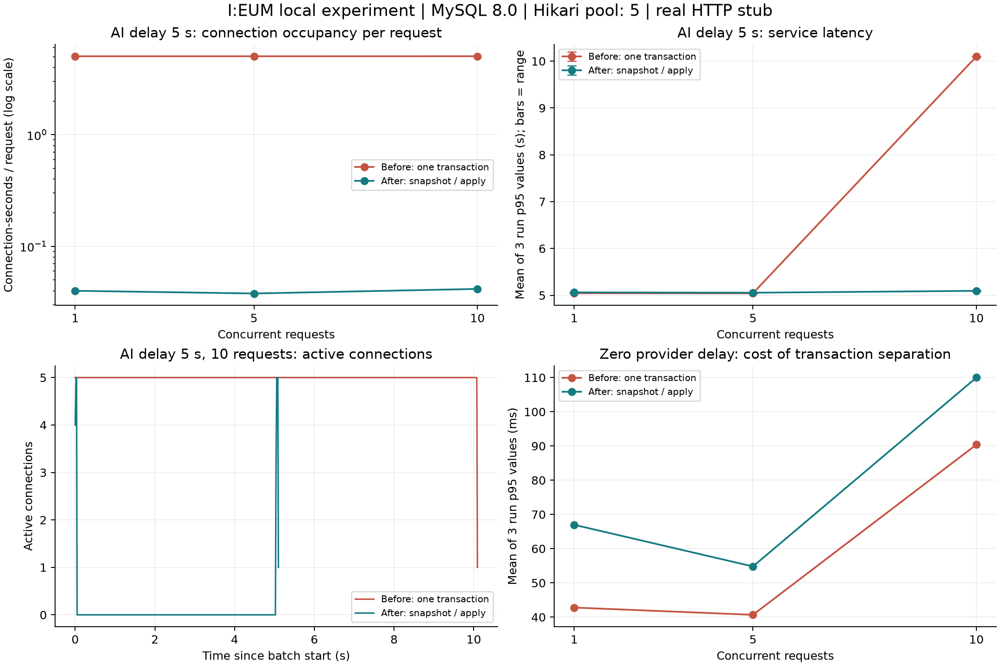

# I:EUM: 외부 API 대기 중 DB 자원 반환과 일정 정합성 검증

2026-11-25에 수행한 사후 개선·로컬 검증이다. 프로젝트 개발 당시의 장애나 의사결정으로 소급하지 않는다.

**직접 자동 배치 API의 외부 대기 구간을 DB 트랜잭션 밖으로 이동하고, 변경 버전 확인과 짧은 행 잠금으로 최신 일정만 반영하도록 구현했다.** MySQL과 실제 HTTP 클라이언트를 사용하는 실험에서 자원 점유 감소와 동시 수정 보호를 함께 확인했다.

## 확인한 결과

AI 지연 5초, 서로 다른 일정에 동시 요청 10개, Hikari 커넥션 풀 5개, 각 방식 3회 반복 조건:

| 지표 | 기존 | 개선 | 해석 |
|---|---:|---:|---|
| 반복별 서비스 p95의 평균 | 10,100.0ms | 5,096.0ms | 약 49.5% 감소 |
| 요청당 커넥션 점유 시간 추정 | 5,049.7ms | 41.5ms | 약 99.2% 감소; 10ms 샘플 적분값 |
| 트랜잭션 1개당 평균 유지 시간 | 5,047.5ms | 20.6ms | 기존은 요청당 1개, 개선은 요청당 2개 |
| 순간 최대 active 커넥션 | 5개 | 5개 | 순간 피크 감소가 아닌 점유 지속 시간 감소 |
| 순간 최대 pending 요청 | 5개 | 5개 | 짧은 조회·반영 단계의 순간 대기는 남음 |
| AI 호출 시 활성 트랜잭션 | 30/30회 | 0/30회 | 실제 호출 스레드에서 계측 |

기존 방식에서는 5개 커넥션이 AI 응답을 기다리는 동안 유지되어 나머지 요청이 다음 차례를 기다렸다. 새 방식은 조회 후 커넥션을 반환하므로 10개 요청이 AI 응답을 기다리는 구간을 겹칠 수 있었다. **AI 자체의 5초 지연을 줄인 결과가 아니다.**

그래프의 점유 시간은 로그 축이다. p95는 요청 전체를 합친 값이 아니라 각 반복에서 구한 p95 3개의 평균이며 오차 막대는 반복 간 최솟값·최댓값이다. 시계열은 첫 반복이며, 각 선은 해당 실행의 관측 종료 시점까지 표시했다.

## 기존 긴 트랜잭션에서도 재현된 동시 수정 문제

별도 재현에서는 장소 3개가 있는 일정에서 AI 응답을 잠시 막았다. 사용자는 방문 순서를 `B→A→C`로 바꾸고, AI는 읽었던 입력의 순서를 뒤집는 유효한 추천을 반환하도록 했다.

| 결과 | 기존 자동 배치 본문 | 새 자동 배치 흐름 |
|---|---:|---:|
| AI 응답 전에 사용자 수정 완료 | 0/3회 | 3/3회 |
| 최종 방문 순서 값의 중복 | 3/3회 | 0/3회 |
| 사용자 지정 순서와 순번을 모두 보존 | 0/3회 | 3/3회 |
| 오래된 추천 충돌 거절 | 0/3회 | 3/3회 |

기존 방식에서는 노드 3개에 방문 순번이 `2, 1, 2`로 남는 결과가 3회 재현되었다. ID를 순번으로 정렬한 목록만 보면 사용자 의도와 같아 보일 수 있으므로, **각 노드의 실제 순번과 중복 여부를 직접 검사했다.**

코드에 대한 원인 분석: 기존 자동 배치와 수동 편집이 서로 다른 시점에 읽은 엔티티 상태를 유지한다. 한쪽 UPDATE가 다른 쪽의 행 잠금을 기다리더라도, 이미 읽었던 모든 엔티티 상태가 자동으로 최신 값으로 갱신되지는 않는다. 각 요청이 변경을 감지한 노드만 갱신하면서 두 작업의 순번이 섞일 수 있다. 이 재현은 한 트랜잭션으로 묶는 것만으로 사용자 수정 보호가 보장되지 않는다는 근거다.

새 방식에서는 사용자의 편집이 완료된 뒤 일정 버전이 달라진 것을 확인하고 추천을 충돌로 거절했다. 실제 HTTP 응답 부하 테스트는 아니며, 서비스의 충돌 ErrorCode가 기존 예외 처리기에 의해 HTTP 409로 매핑된다.

원시 결과: [동시 수정 전후 3회 비교](results/baseline-concurrent-edit.json).

## 구현에서 보장하는 범위

1. 짧은 트랜잭션에서 소유권·일정·노드·관광지·기존 간선·캐시와 변경 버전을 읽는다. 일정 그래프를 detach하고 커밋한다.
2. DB 변경 없이 요청 전용 그래프에서 날짜 배치, 필요한 Kakao 조회, AI 호출, 응답 검증을 수행한다.
3. 부모 일정 행을 잠근 짧은 트랜잭션에서 버전과 원래 상태를 다시 확인한다. 변경되었으면 거절하고, 그대로면 날짜·순서·새 간선·새 캐시·버전을 함께 반영한다.

장소 추가·삭제·재배치와 일정 수정·삭제도 같은 부모 행 잠금 규칙에 참여한다. 자식 노드 수정에도 `route_revision`이 증가한다. 버전 확인 후 실제 쓰기 전까지 다른 편집이 끼어들 수 없도록 확인과 반영을 같은 트랜잭션에서 수행한다. 서로 다른 일정의 캐시 저장 충돌은 고유 키 기반 upsert로 처리한다.

## 실패·회귀 검증

정합성 테스트 **14개 모두 통과**:

- Kakao·AI 호출 중 트랜잭션 비활성, AI 대기 중 중간 변경 비노출.
- AI HTTP 500·타임아웃·잘못된 결과, 두 번째 Kakao 조회 실패 시 노드·버전·간선·새 캐시 불변.
- AI 대기 중 순서 변경·날짜 이동·미배치 전환·장소 추가·삭제·기간 수정·수정 후 되돌리기: 편집 보존 및 오래된 추천 거절.
- 일정 삭제, 같은 일정의 동시 추천에서 1개 성공·1개 충돌, 서로 다른 일정의 동시 캐시 미스.
- 최종 Edge INSERT에 DB 오류를 주입한 경우 앞서 수행한 캐시 INSERT·노드·버전 변경까지 롤백.
- 상위 트랜잭션의 전체 롤백 계약, 소유자 검사, 고정 시작·종료 조건 유지.

추가로 위 동시 수정 비교 3회가 통과했다. 변경한 잠금 경로와 관련된 기존 노드·일정 단위 테스트 **9개도 통과**했다. 저장소 전체 테스트의 통과를 주장하는 결과는 아니다. 기존 테스트의 오래된 ToolExecutionContext 생성자 호출을 현재 시그니처에 맞춰 테스트 컴파일을 복구했다.

## 성능 실험 조건

| 항목 | 조건 |
|---|---|
| 환경 | Windows 11, Java 17.0.19, JVM 가용 논리 프로세서 22개, 로컬 Docker MySQL 8.0 |
| DB | 전용 `ieum_experiment`, 임시 메모리 볼륨, Hikari 최대 5개 |
| 비교군 | HEAD `4a6a4a2`의 자동 배치 서비스 본문 보존. 두 방식에서 같은 현재 공통 저장소·클라이언트 사용 |
| 측정 경계 | 실제 서비스 메서드 + 실제 HTTP 공급자 클라이언트. 인증·서블릿·API 서버 오버헤드는 제외 |
| 주 실험 | 장소 3개·날짜 지정·경로와 캐시 준비. AI 0/2/5초 × 동시 요청 1/5/10 × 각 3회 × 전후 = 54회 |
| 보조 실험 | 장소 3개·미배치·캐시 없음. 구간별 Kakao 100ms·AI 2초·동시 요청 5개 × 각 3회 × 전후 = 6회 |
| 통제 | 서로 다른 일정, 동일 데이터 형태·응답·풀 크기. 캐시 충돌 효과는 별도 정합성 테스트로 분리 |
| 워밍업·순서 | 방식별 5회 워밍업 제외, 반복마다 전후 실행 순서 교차 |
| 계측 | Hikari active/pending 10ms 표본, 실제 간격으로 점유량 적분. 트랜잭션 시작 완료부터 리소스 정리 직전까지 별도 계측 |

총 **60회, 측정 요청 318건 중 실패 0건**. 각 반복의 요청 수가 작으므로 p95는 안정적인 운영 지연 분포나 SLA를 의미하지 않는다. 원래 서비스 본문 보존과 측정 당시 소스 해시도 확인했다.

## 개선되지 않은 조건과 비용

| 조건 | 기존 반복별 p95 평균 | 개선 반복별 p95 평균 | 판단 |
|---|---:|---:|---|
| AI 5초·동시 요청 1개 | 5,045.2ms | 5,063.1ms | 공급자 지연 자체는 동일, 분리 비용 추가 |
| AI 0초·동시 요청 5개 | 40.7ms | 54.8ms | 짧은 작업에서는 두 번의 트랜잭션·재조회 비용이 더 큼 |
| AI 2초·Kakao 100ms·캐시 없음·동시 요청 5개 | 2,785.0ms | 2,734.5ms | 지연 감소는 작음. 요청당 커넥션 점유 추정은 2,779.8ms → 62.0ms |

보조 실험에서 양쪽 모두 반복당 AI 5회·Kakao 30회를 호출했다. 이 실험의 성과는 외부 호출 수 축소가 아니라 **같은 외부 대기 동안 DB 커넥션을 반환하는 것**이다.

## 남은 한계

- 직접 자동 배치 API를 개선했다. 자연어 Tool Calling의 상위 트랜잭션 안에서 호출되면 기존 일괄 롤백을 유지하는 경로를 사용하므로, 자연어 명령 전체의 외부 대기는 아직 최적화 대상이다.
- 외부 호출은 동기 대기이므로 요청 스레드는 계속 사용한다. 실제 공급자의 품질·네트워크·요금과 운영 처리 한계는 검증하지 않았다.
- 충돌 시 자동으로 최신 일정에 재적용하지 않고 재요청을 요구한다. 이미 수행한 외부 호출 비용은 DB 롤백으로 되돌릴 수 없다.
- 10ms보다 짧은 커넥션 점유는 샘플에서 누락될 수 있다. 점유 추정치와 별도의 트랜잭션 시간 계측을 함께 제시했다.
- 실험용 전체 엔티티 스키마 생성 중 기존 FCM 토큰 인덱스 길이 경고가 있었다. 실험 대상의 Edge·경로 캐시 고유 제약 2개는 실제 생성되어 있음을 별도 조회로 확인했다. FCM 기능은 실험하지 않았다.
- 수동 장소 삭제 후 새 인접 경로 확보, 캐시 만료·갱신 정책, 중복 외부 요청 합치기는 별도 과제다.

## 포트폴리오에 사용할 수 있는 문장

> 프로젝트 종료 후 자동 배치의 외부 API 대기 구간과 트랜잭션 범위를 재검토했다. 일정 스냅샷으로 외부 조회와 AI 추천을 수행하고, 변경 버전과 짧은 행 잠금으로 최신 일정만 원자적으로 반영하도록 개선했다. 로컬 MySQL·HTTP Stub 환경에서 AI 지연 5초, 동시 요청 10개, 커넥션 풀 5개 조건으로 각 3회 비교해 반복별 서비스 p95 평균을 10.10초에서 5.10초로 줄였다. 동시 수정 재현에서는 기존 방식의 방문 순번 중복을 확인했고, 개선 후에는 오래된 추천을 거절해 사용자 수정을 보존했다. 외부 지연이 없는 조건의 추가 비용과 자연어 명령 경로의 남은 한계도 구분했다.

## 산출물과 재현

- [설계·시나리오·재현 명령](DESIGN.md)
- [반복별 원시 측정](results/summary.csv), [커넥션 원시 시계열](results/timeseries.csv), [전체 집계표](results/aggregate.md)
- [측정 환경](results/environment.json), [측정 당시 소스 해시](results/source-manifest.json)
- [정합성·성능 JUnit 원본](results/correctness-and-performance.xml), [동시 수정 비교 JUnit 원본](results/concurrent-edit-probe.xml)
- [그래프 PNG](results/comparison.png), [편집 가능한 SVG](results/comparison.svg)

측정값을 문서에 옮기기 전에 원시 CSV와 집계 결과를 대조했으며, 그래프를 렌더링해 확인했다.
